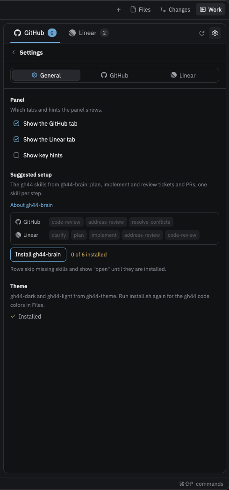
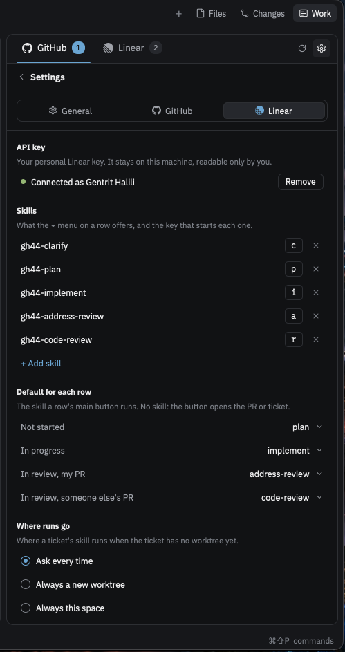
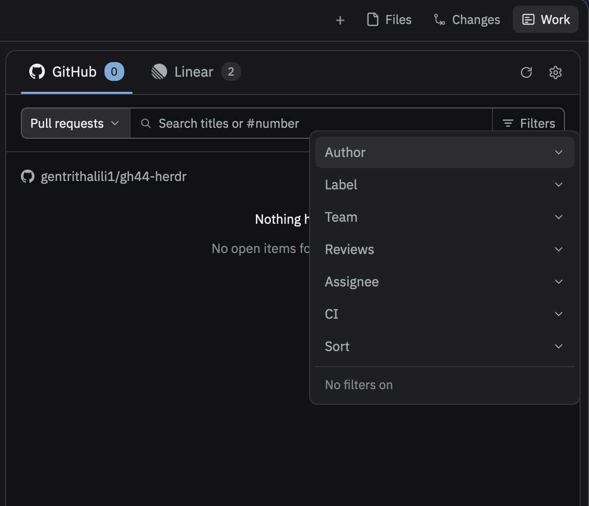
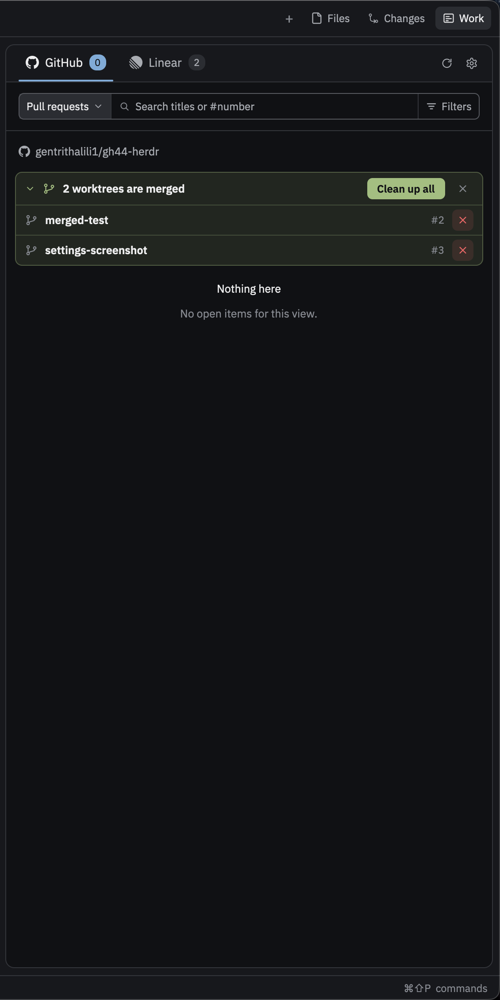

# gh44-herdr

A setup for the [Herdr app](https://herdr.dev): the `gh44-herdr` layout, keys, settings, gh44 mods.

## Work panel

One window for the whole loop: the work to do (Linear tickets, GitHub PRs), the code (spaces and worktrees), and the agents that work on it. Each ticket or PR is linked to a skill, and the skill runs as an agent in the right place.

The layout's **Work panel** (the `hub` mod) lists your tickets and PRs. Each row has a button that starts its skill in a new Claude tab, in the ticket's worktree. The agent shows up in the sidebar, and the row shows its status.

Pick the skills in the panel's ⚙ settings: your own, or the gh44 ones from [gh44-brain](https://github.com/gentrithalili1/gh44-brain). A row without an installed skill shows `open`, which opens the PR or ticket.

## Community mods

| Mod                                                                                  | What it does                                                                                                     |
| ------------------------------------------------------------------------------------ | ---------------------------------------------------------------------------------------------------------------- |
| [herdr-code-review](https://github.com/sangit0/herdr-code-review) (`tabbed-changes`) | Source control panel in the Changes slot: changed files and diffs open in tabs, plus history and review comments |
| [herdr-revive](https://github.com/dmazlum/herdr-revive)                              | Brings back the agent a terminal lost after a restart, and forks a live one                                      |
| [herdr-auto-title](https://github.com/kryptamine/herdr-auto-title)                   | Service behind `auto-title` that names tabs from what the agent is doing                                         |

## Install

With the Herdr app open:

```sh
git clone https://github.com/gentrithalili1/gh44-herdr.git
cd gh44-herdr
./install.sh
```

It installs the mods, keys, settings and layout. Your old files are kept as `<name>.bak-<time>`. Then pick the skills each row runs in the Work panel's ⚙ settings.

To remove it:

```sh
./uninstall.sh
```

## Optional

- **Theme:** clone [gh44-theme](https://github.com/gentrithalili1/gh44-theme) next to this repo before installing, for the `gh44-dark` and `gh44-light` themes.
- **Skills:** install [gh44-brain](https://github.com/gentrithalili1/gh44-brain) for the gh44 skills the Work panel runs. It also sets up its own `CLAUDE.md` and rules.

## What's here

| Path                         | What                                                                                  |
| ---------------------------- | ------------------------------------------------------------------------------------- |
| `layouts/gh44-herdr.json`    | The layout                                                                            |
| `keys.json`, `settings.json` | Keys and settings                                                                     |
| `mods/`                      | gh44 mods: `hub` (work panel), `gh44-herdr-tabs` (tab bar), `auto-title` (names tabs) |
| `mods.txt`                   | Mods without an installer, copied from GitHub                                         |
| `plugins.txt`                | Mods with their own installer                                                         |
| `install.sh`                 | Sets up this machine                                                                  |
| `uninstall.sh`               | Removes it all and brings back your old keys and settings                             |
| `sync.sh`                    | Copies the live layout, keys and settings back here                                   |
| `reload.sh`                  | Reloads the linked mods                                                               |
| `tests/`                     | Work panel settings tests: `node --test tests/*.test.js`                              |

## Screenshots

<p>
  
  
  
  
  
  
</p>
