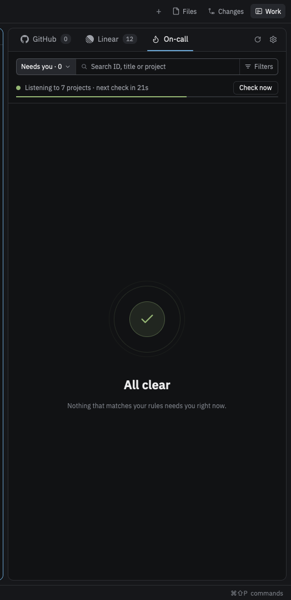
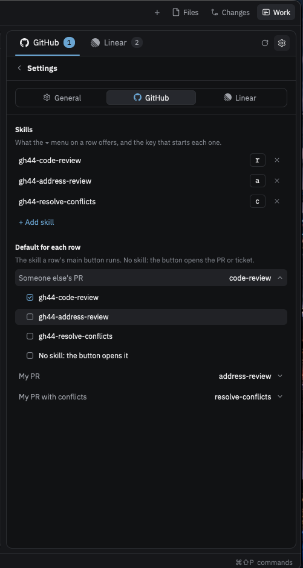

<p align="center"></p>
<h1 align="center">gh44-omnia</h1>
<p align="center"><strong>Tickets, code and the agents that work on them, in one Herdr window.</strong></p>
<p align="center">
<a href="https://herdr.dev"></a>
<a href="https://claude.com/claude-code"></a>


<a href="https://github.com/gentrithalili1/gh44-omnia/commits/main"></a>
<a href="https://github.com/gentrithalili1/gh44-omnia/stargazers"></a>
</p>

A [Herdr](https://herdr.dev) setup where each Linear ticket and GitHub PR gets a button that runs its skill as a Claude agent, in the right worktree.

## Features

- **Work panel:** your tickets and PRs, each with its skill and the agent's status.
- **On-call:** watches Sentry and notifies you only about issues in your domain, with an AI report and a fix. [More](mods/hub/oncall/README.md)
- **Repo skills:** a repo's own `.claude/skills` show up while you work in it.
- **Community mods:** [code review](https://github.com/sangit0/herdr-code-review), [revive](https://github.com/dmazlum/herdr-revive) and [auto-title](https://github.com/kryptamine/herdr-auto-title) included.

## Install

With the Herdr app open:

```sh
git clone https://github.com/gentrithalili1/gh44-omnia.git
cd gh44-omnia
./install.sh
```

Then pick the skills each row runs in the Work panel's ⚙ settings. Your old files are kept as `<name>.bak-<time>`; `./uninstall.sh` puts them back.

Optional: [gh44-theme](https://github.com/gentrithalili1/gh44-theme) (clone next to this repo first) and [gh44-brain](https://github.com/gentrithalili1/gh44-brain) for the gh44 skills.

## Screenshots

<table>
  <tr>
    <th>Work panel</th>
    <th>On-call</th>
    <th>Filters</th>
    <th>Clean up</th>
  </tr>
  <tr>
    <td align="center"></td>
    <td align="center"></td>
    <td align="center"></td>
    <td align="center"></td>
  </tr>
  <tr>
    <th>General settings</th>
    <th>GitHub settings</th>
    <th>Linear settings</th>
  </tr>
  <tr>
    <td align="center"></td>
    <td align="center"></td>
    <td align="center"></td>
  </tr>
</table>

## What's here

| Path                         | What                                                          |
| ---------------------------- | ------------------------------------------------------------- |
| `layouts/gh44-omnia.json`    | The layout                                                    |
| `keys.json`, `settings.json` | Keys and settings                                             |
| `mods/`                      | `hub` (Work panel), `gh44-omnia-tabs` (tab bar), `auto-title` |
| `install.sh`, `uninstall.sh` | Set up or remove it                                           |
| `sync.sh`, `reload.sh`       | Copy the live setup back here; reload the mods                |
| `tests/`                     | `node --test tests/*.test.js`                                 |
