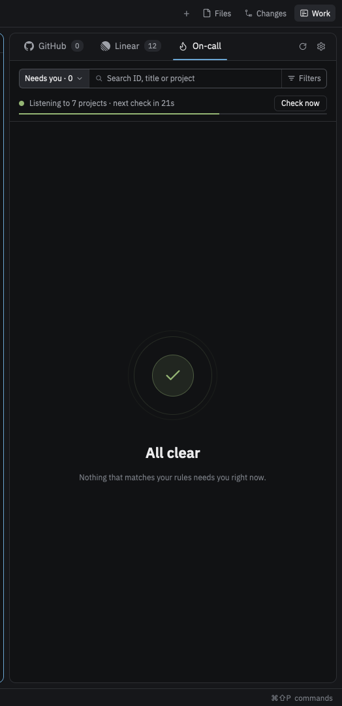

# On-call

The On-call tab of the Work panel. While you are on call, it watches your error tracker and tells you only about the issues that need you.

## Set up

In the Work panel, open ⚙ settings › On-call and follow the steps:

1. **Token.** Paste a token for your tracker. It stays on this machine, readable only by you.
2. **Org and projects.** Pick what to watch.
3. **Repo.** Pick the checkout you are on call for. A short scan reads its CODEOWNERS and the noise rules of its SDK setup, so the AI knows the repo.
4. **Domain.** Describe what you own, in words or as CODEOWNERS lines.

Then switch **On call** on. Checks run in the background, also with Herdr closed, until you switch it off.

## How an issue is decided

Each check, every new, regressed or escalating issue goes through these steps. Each step can stop it.

1. **Free filters.** No AI: the tracker's priority and a minimum of events or users.
2. **Domain check.** A quick, cheap AI call: is it in your domain? Issues outside it stop here.
3. **Triage.** The triage skill reads the issue, the stack and your repo, then writes a report with the cause, the owner, the severity and a suggested diff.
4. **Notify.** You get a notification when the issue matches your rules and its severity is one you picked.

Every issue stays in the list with who decided it and why. Open the report, re-run the triage, or start any of your skills on it from the row.

## Triage skill

On-call ships its own skill, [`oncall-triage`](skills/oncall-triage/SKILL.md), and uses it by default. To use your own, pick any installed skill under ⚙ settings › On-call › Triage skill. Whatever the skill, On-call adds your domain, your rules and the answer format it needs.

## Providers

A provider connects On-call to one issue tracker. Sentry is the first.

| Provider | Token                                                  |
| -------- | ------------------------------------------------------ |
| Sentry   | Personal token with org:read, project:read, event:read |

### Add a provider

1. Add its entry to [`providers/catalog.js`](providers/catalog.js): its name, token help and labels, the pattern that finds its SDK setup files, and its read-only MCP tools for the AI.
2. Add `providers/<id>.mjs` with the `ProviderApi` of [`providers/contract.js`](providers/contract.js): list orgs, projects and issues, and get one issue and its latest event.
3. Register it in [`providers/index.mjs`](providers/index.mjs).

The service, the prompts and the settings only use the contract and the catalog, so nothing else changes.

## Files

| Path          | What                                                          |
| ------------- | ------------------------------------------------------------- |
| `view.js`     | The tab: list, filters, status line and row actions           |
| `settings.js` | The settings section and its setup steps                      |
| `config.js`   | The saved setup, read safely by the panel and the service     |
| `client.js`   | The panel's I/O: token, service start and stop, its files     |
| `service/`    | The background service: checks, filters, AI triage, repo scan |
| `providers/`  | One file per tracker, behind one contract                     |
| `skills/`     | The default triage skill                                      |

Tests: `node --test tests/oncall.test.js`.
